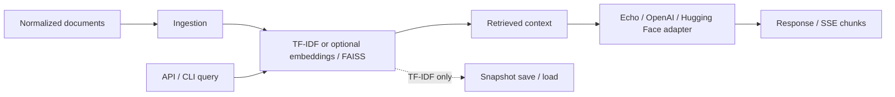

# Local LLM Chat Engine

A production-oriented Python RAG backend connecting document ingestion and retrieval to interchangeable local or hosted model adapters. It includes an API, CLI, tests, and Docker packaging; it is not a claim of production readiness.

## Problem and architecture

Retrieval experiments become difficult to maintain when ingestion, indexing, model calls, and API behavior are coupled. This project separates those responsibilities so each backend can be inspected and replaced.



**Design choices:** TF-IDF provides a lightweight baseline; optional dense retrieval adds dependencies and model downloads. Model adapters isolate generation from retrieval. The root modules are the application implementation; the `local_llm_chat_engine/` package exposes compatibility imports.

**Stack:** Python, FastAPI, scikit-learn, optional sentence-transformers/FAISS and model SDKs, pytest, Docker.

## What this service provides

- FastAPI endpoints for ingestion, search, chat, and streaming chat.
- Retrieval backends:
	- TF-IDF (always available)
	- Embeddings + `sentence-transformers` (optional)
	- FAISS (optional)
- Adapter pattern for model backends (`echo`, `openai`, `hf`).
- Snapshot save/load endpoints for TF-IDF store persistence.
- Optional API key protection for write endpoints.

## Quick start

Install core dependencies:

```bash
cd local-llm-chat-engine
python -m pip install -r requirements.txt
```

Install optional model/retrieval dependencies:

```bash
python -m pip install -r requirements-optional.txt
```

Run the API:

```bash
uvicorn app:app --reload --port 8001
```

Smoke test:

```bash
curl -s -X POST "http://127.0.0.1:8001/ingest" \
	-H "Content-Type: application/json" \
	-d '{"documents":[{"id":"1","text":"RAG combines retrieval and generation"}]}'

curl -s -X POST "http://127.0.0.1:8001/chat" \
	-H "Content-Type: application/json" \
	-d '{"message":"Explain RAG briefly","model":"echo"}'
```

## Configuration

Environment variables:

You can start from `.env.example` and set required values.

- `LOCAL_LLM_HOST` (default: `0.0.0.0`)
- `LOCAL_LLM_PORT` (default: `8001`)
- `LOCAL_LLM_LOG_LEVEL` (default: `INFO`)
- `LOCAL_LLM_DEFAULT_K` (default: `3`)
- `LOCAL_LLM_MAX_K` (default: `20`)
- `LOCAL_LLM_API_KEY` (optional; if set, required via `X-API-Key` on write endpoints)
- `LOCAL_LLM_CORS_ORIGINS` (optional comma-separated list)
- `LOCAL_LLM_SNAPSHOT_PATH` (default: `./data/store.pkl`)
- `LOCAL_LLM_AUTOLOAD_SNAPSHOT` (default: `true`)
- `LOCAL_LLM_FAIL_ON_SNAPSHOT_ERROR` (default: `false`)
- `LOCAL_LLM_STREAM_CHUNK_SIZE` (default: `64`)
- `LOCAL_LLM_RATE_LIMIT_ENABLED` (default: `false`)
- `LOCAL_LLM_RATE_LIMIT_REQUESTS_PER_MINUTE` (default: `120`)
- `LOCAL_LLM_RATE_LIMIT_WINDOW_SECONDS` (default: `60`)
- `LOCAL_LLM_RATE_LIMIT_EXEMPT_PATHS` (default: `/health,/ready`)

## API and docs

- API reference: `docs/api.md`
- Architecture: `docs/architecture.md`
- Embeddings: `docs/embeddings.md`
- FAISS runbook: `docs/faiss_runbook.md`
- Adapters + streaming: `docs/adapters.md`
- Operations: `docs/operations.md`
- Deployment: `docs/deployment.md`
- Security: `docs/security.md`

## CLI usage

The CLI supports ingest/query/stats and snapshot operations:

```bash
python cli.py ingest examples/sample_docs.jsonl --save
python cli.py query "retrieval architecture" --k 3
python cli.py stats
python cli.py save --path ./data/store.pkl
python cli.py load --path ./data/store.pkl
```

## Testing and quality

```bash
python -m pip install -r requirements.txt
python -m pip install -r requirements-dev.txt
python -m pytest -q
python -m flake8 .
```

CI runs on push/PR and executes lint + tests on Python 3.10 and 3.11.


## Evaluation, limitations, and roadmap

Tests exercise retrieval, adapters, API behavior, and rate limiting. They do not establish answer quality, safety, load capacity, or production SLOs. The echo adapter makes smoke tests independent of model credentials.

- TF-IDF ingestion rebuilds the index; the baseline is intended for small datasets.
- Snapshot persistence covers TF-IDF state, not a durable FAISS database. Only load trusted pickle snapshots.
- OpenAI can stream native tokens; Hugging Face output is chunked after generation.
- Dense retrieval and real model integrations require optional dependencies and separate validation.
- Optional API keys and in-memory rate limits are not multi-tenant authorization.

See [architecture](docs/architecture.md), [operations](docs/operations.md), [security](docs/security.md), and [roadmap](docs/roadmap.md). Async inference/background ingestion, metrics/tracing, pluggable storage, and multi-tenant authorization remain roadmap work.

## License

See [LICENSE](LICENSE) for the repository license.
